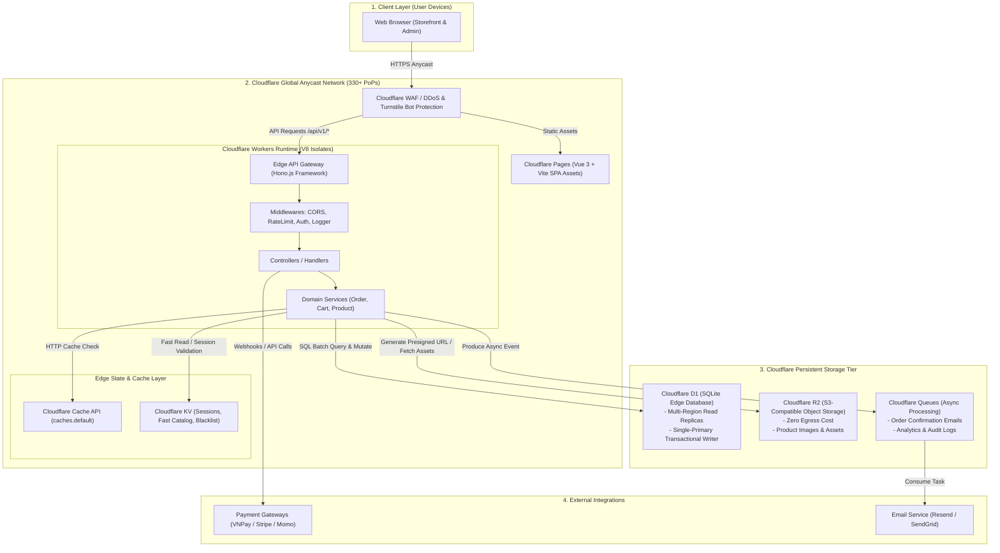
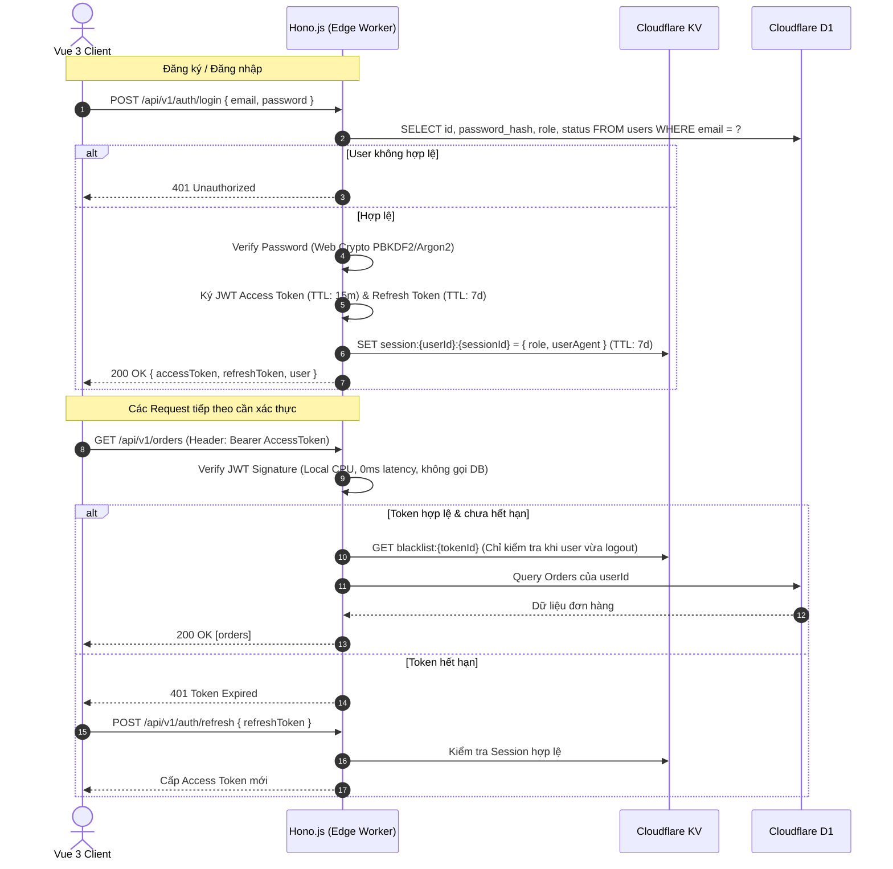
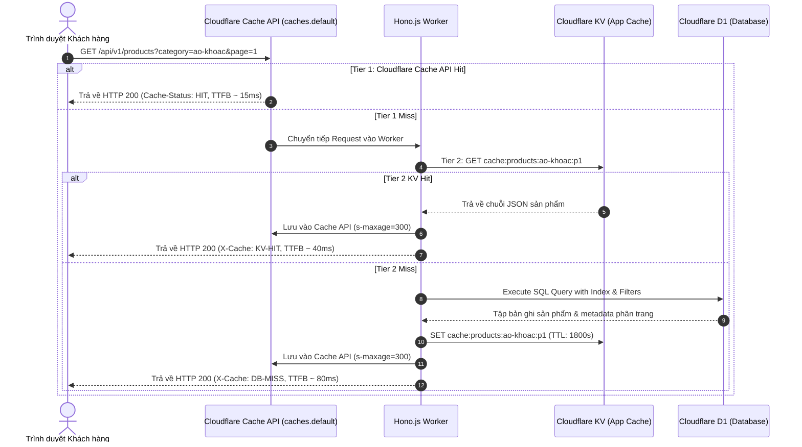

# System Architecture Document - EdgeCart

## 1. Kiến trúc Tổng thể (High-Level Edge-First Architecture)

EdgeCart được thiết kế 100% theo triết lý **Edge-Native Serverless**. Toàn bộ vòng đời của một HTTP Request từ trình duyệt của khách hàng đến các dịch vụ lưu trữ dữ liệu đều được xử lý trực tiếp tại điểm biên (Edge PoP) gần người dùng nhất trên mạng lưới Cloudflare.



---

## 2. Chi tiết các Thành phần Hệ thống (Component Details)

### 2.1 Frontend: Vue 3 SPA on Cloudflare Pages
- **Framework**: Vue 3 (Composition API, `<script setup>`, TypeScript).
- **Build Tool**: Vite cho tốc độ build vượt trội và HMR tức thì.
- **Styling**: Tailwind CSS với kiến trúc Utility-First, tối ưu hóa CSS purge để dung lượng file CSS < 20KB gzip.
- **State Management**:
  - `Pinia`: Quản lý client state (User session, Theme, UI Dialogs, Local Cart).
  - `@tanstack/vue-query`: Quản lý server state, tự động cache, background refetch, stale-while-revalidate, và optimistic updates.
- **Hosting**: Cloudflare Pages phân phối tĩnh toàn cầu qua HTTP/3, tự động kích hoạt Brotli/Gzip compression.

### 2.2 Backend API: Hono.js on Cloudflare Workers
- **Runtime**: Cloudflare Workers (V8 Isolate). Ưu điểm:
  - Khởi động < 5ms (loại bỏ hoàn toàn cold-start so với AWS Lambda hay container).
  - Tiêu thụ bộ nhớ thấp (~1MB memory per isolate).
  - Chuẩn hóa theo tiêu chuẩn Web Standards (`fetch`, `Request`, `Response`, `Web Crypto`).
- **Framework Hono.js**:
  - Siêu nhẹ (< 15KB footprint).
  - Hệ thống định tuyến RegexpRouter tối ưu hóa tốc độ matching đường dẫn.
  - Hỗ trợ Middleware mạnh mẽ (JWT validation, CORS, Secure Headers, Rate Limiting, Zod validator).
  - Tích hợp Type-safe RPC giữa frontend và backend khi chia sẻ DTO/Schema.

### 2.3 Database Tier: Cloudflare D1 (Edge SQLite)
- D1 là cơ sở dữ liệu quan hệ phân tán dựa trên SQLite.
- **Cơ chế hoạt động**:
  - **Read Queries**: Được phục vụ từ bản sao (Read Replica) tại vị trí gần người dùng nhất, mang lại độ trễ đọc dưới 15ms.
  - **Write Queries**: Được tự động chuyển tiếp (proxied) về **Primary Database Location** để đảm bảo tính nhất quán mạnh (Strict Serializability / ACID).
  - **Batching Support**: Sử dụng `env.DB.batch([stmt1, stmt2, ...])` để thực thi nhiều câu lệnh trong một round-trip mạng duy nhất, tối ưu hóa tốc độ checkout và trừ kho.

### 2.4 Caching & Session Tier: Cloudflare KV
- KV là kho lưu trữ Key-Value toàn cầu với độ trễ đọc siêu thấp (< 10ms).
- **Ứng dụng trong EdgeCart**:
  - Lưu trữ JWT Refresh Token và Session Whitelist/Blacklist.
  - Lưu trữ Idempotency Keys (chống submit đơn hàng trùng lặp) với thời gian hết hạn TTL (Time-To-Live).
  - Caching các danh mục sản phẩm (Category Tree) và thông tin cấu hình hệ thống (Store Settings).
  - Cache các phản hồi của trang chi tiết sản phẩm PDP để giảm tải cho D1.

### 2.5 Object Storage Tier: Cloudflare R2
- Tương thích 100% chuẩn S3 API.
- **Đặc điểm sống còn cho E-commerce**: **Không tính phí Egress (Zero egress fees)**. Giúp tiết kiệm hàng nghìn USD chi phí băng thông tải ảnh sản phẩm so với AWS S3.
- **Cơ chế Upload**: Áp dụng mô hình **Direct Presigned URL**. Khách hàng hoặc Admin yêu cầu một Presigned URL từ Hono API, sau đó trình duyệt upload trực tiếp tệp ảnh lên R2, không làm nghẽn CPU hay băng thông của Worker.

### 2.6 Message Queue & Async Processing: Cloudflare Queues
- Đảm bảo tính tin cậy cho các tác vụ nền:
  - Gửi email xác nhận đơn hàng qua Resend/SendGrid.
  - Đồng bộ số liệu phân tích đơn hàng vào bảng Analytics.
  - Tự động hủy đơn hàng quá hạn thanh toán sau 30 phút.

---

## 3. Luồng Tương tác Hệ thống Chi tiết (Detailed Sequence Diagrams)

### 3.1 Luồng Xác thực Phân quyền (Authentication & Authorization)



### 3.2 Luồng Tìm kiếm & Caching Sản phẩm (Multi-tier Caching)



---

## 4. Chiến lược Cache & Invalidation (Caching Strategy)

### 4.1 Mô hình Phân tầng Cache (Cache Tiering)
1. **Tier 1: Cloudflare HTTP Cache API (`caches.default`)**:
   - Áp dụng cho các GET endpoints công khai (`/api/v1/products`, `/api/v1/categories`).
   - Sử dụng Header: `Cache-Control: public, max-age=60, s-maxage=600, stale-while-revalidate=30`.
   - Lưu trữ bản dựng tĩnh JSON trực tiếp tại Edge PoP cục bộ của người dùng.
2. **Tier 2: Cloudflare KV Data Cache**:
   - Dùng để lưu trữ các object đã serialize: Thông tin chi tiết sản phẩm (`product:{id}`), cây danh mục (`category:tree`), cấu hình cửa hàng.
   - TTL trung bình: 1 giờ đến 24 giờ.
3. **Tier 3: Vue Query Client Cache**:
   - Caching tại bộ nhớ RAM của trình duyệt người dùng với thời gian `staleTime: 5 * 60 * 1000` (5 phút). Tránh gọi API khi người dùng chuyển qua lại giữa các tab/trang.

### 4.2 Cơ chế Cache Invalidation (Chủ động & Bất đồng bộ)
Khi Quản trị viên cập nhật hoặc xóa sản phẩm/danh mục thông qua Admin Portal:
1. Hono API thực hiện cập nhật dữ liệu trong D1.
2. Hono API xóa ngay lập tức các Key liên quan trong Cloudflare KV (`KV.delete('product:' + id)`).
3. Hono API kích hoạt Cloudflare Purge API qua Worker Service Binding hoặc Cloudflare API Token để xóa URL tương ứng khỏi Tier 1 Edge Cache:
   ```typescript
   // Invalidate cache tags hoặc URL
   await fetch(`https://api.cloudflare.com/client/v4/zones/${ZONE_ID}/purge_cache`, {
     method: 'POST',
     headers: { Authorization: `Bearer ${CF_API_TOKEN}`, 'Content-Type': 'application/json' },
     body: JSON.stringify({ tags: [`product-${id}`, 'catalog'] })
   });
   ```

---

## 5. Chiến lược Xử lý Tồn kho & Giải quyết Race Condition (Inventory & Concurrency Control)

Một trong những thách thức lớn nhất của E-commerce trên Edge Database (Cloudflare D1/SQLite) là nguy cơ **Bán vượt tồn kho (Over-selling)** khi diễn ra Flash-sale với hàng nghìn lượt mua đồng thời.

### 5.1 Bản chất của Cloudflare D1
- D1 sử dụng SQLite engine với **Single Primary Coordinator** cho các thao tác ghi (Writes).
- Mọi câu lệnh ghi đều được tuần tự hóa (serialized), loại bỏ hoàn toàn hiện tượng dirty-read hoặc non-repeatable read ở cấp độ database engine.
- Tuy nhiên, nếu áp dụng mô hình `SELECT stock` sau đó kiểm tra ở code TypeScript rồi mới `UPDATE`, race condition vẫn sẽ xảy ra giữa khoảng thời gian giữa SELECT và UPDATE.

### 5.2 Giải pháp: Atomic Conditional Update kết hợp Batching
EdgeCart áp dụng kỹ thuật **Atomic Conditional UPDATE** trực tiếp trong câu lệnh SQL. Tồn kho chỉ được trừ nếu số lượng hiện tại lớn hơn hoặc bằng số lượng yêu cầu:

```sql
-- Câu lệnh atomic trừ tồn kho
UPDATE product_variants
SET stock_quantity = stock_quantity - ?1,
    updated_at = CURRENT_TIMESTAMP
WHERE id = ?2 
  AND stock_quantity >= ?1;
```

Trong Hono Service:
```typescript
const result = await env.DB.prepare(`
  UPDATE product_variants 
  SET stock_quantity = stock_quantity - ?1, updated_at = CURRENT_TIMESTAMP 
  WHERE id = ?2 AND stock_quantity >= ?1
`).bind(item.quantity, item.variantId).run();

if (result.meta.changes === 0) {
  // Số dòng thay đổi = 0 nghĩa là tồn kho không đủ tại thời điểm ghi!
  throw new InsufficientStockError(`Sản phẩm variant ${item.variantId} không đủ tồn kho`);
}
```

### 5.3 Thực thi Nguyên tử (Atomic Checkout Transaction) với D1 Batch
D1 cung cấp hàm `env.DB.batch([...])` đóng gói tất cả các câu lệnh trừ kho, tạo đơn hàng, tạo chi tiết đơn hàng và ghi log biến động kho vào **một transaction duy nhất**:

```typescript
const statements: D1PreparedStatement[] = [];

// 1. Câu lệnh trừ tồn kho cho từng item
for (const item of cartItems) {
  statements.push(
    env.DB.prepare(`
      UPDATE product_variants 
      SET stock_quantity = stock_quantity - ?1 
      WHERE id = ?2 AND stock_quantity >= ?1
    `).bind(item.quantity, item.variantId)
  );
  
  // Ghi audit ledger kho hàng
  statements.push(
    env.DB.prepare(`
      INSERT INTO inventory_logs (id, variant_id, order_id, change_quantity, type, notes)
      VALUES (?, ?, ?, ?, 'ORDER_DEDUCT', 'Khách đặt hàng')
    `).bind(crypto.randomUUID(), item.variantId, orderId, -item.quantity)
  );
}

// 2. Câu lệnh tạo đơn hàng
statements.push(
  env.DB.prepare(`
    INSERT INTO orders (id, user_id, order_number, total_amount, status, payment_method)
    VALUES (?, ?, ?, ?, 'PENDING', ?)
  `).bind(orderId, userId, orderNumber, totalAmount, paymentMethod)
);

// 3. Thực thi toàn bộ trong 1 batch transaction
// Nếu bất kỳ statement nào thất bại (ví dụ: changes === 0 do hết hàng),
// toàn bộ batch sẽ bị rollback tự động bởi D1!
await env.DB.batch(statements);
```

### 5.4 Chống Trùng lặp Đơn hàng (Idempotency Control)
- Client bắt buộc phải tạo một header `Idempotency-Key: <UUIDv4>` khi gọi endpoint checkout.
- Hono Middleware sẽ kiểm tra khóa này trong Cloudflare KV:
  1. Nếu key đang tồn tại ở trạng thái `PROCESSING`: trả về HTTP `409 Conflict` (yêu cầu đang được xử lý).
  2. Nếu key đã có kết quả hoàn tất: trả về trực tiếp kết quả đơn hàng cũ (HTTP `200 OK`) mà không trừ kho lần hai.
  3. Nếu chưa có: Set key vào KV với TTL 120s và tiến hành xử lý checkout.

---

## 6. Kiến trúc Bảo mật & Tuân thủ (Security Architecture)

### 6.1 Bảo vệ Tầng Edge (WAF & DDoS)
- **Cloudflare Managed Rulesets**: Tự động chặn các cuộc tấn công SQL Injection, XSS, Path Traversal trước khi chạm tới Worker.
- **Cloudflare Turnstile**: Tích hợp CAPTCHA vô hình tại các trang Checkout và Login để ngăn chặn credential stuffing và checkout bots.
- **Rate Limiting tại Edge**:
  - `/api/v1/auth/login`: Tối đa 5 requests / IP / phút.
  - `/api/v1/checkout`: Tối đa 10 requests / IP / phút.
  - Public Catalog API: Tối đa 120 requests / IP / phút.

### 6.2 Mã hóa & Mật khẩu (Web Crypto API)
Do Cloudflare Workers chạy trên môi trường V8 Isolate (không có Node.js native `crypto` module hay C++ addons như `bcrypt`), hệ thống sử dụng:
- **Thuật toán**: `PBKDF2` với `HMAC-SHA256`, 100,000 iterations và unique salt 16-byte ngẫu nhiên thông qua Web Crypto API chuẩn (`crypto.subtle`). Hoặc WASM-compiled `Argon2id`.
- Đảm bảo an toàn tuyệt đối chống tấn công Rainbow table và GPU brute-force.

### 6.3 CORS & Security Headers
Hono.js thiết lập các HTTP headers nghiêm ngặt cho toàn bộ phản hồi:
```typescript
app.use('*', cors({
  origin: (origin, c) => {
    const allowedOrigins = [c.env.APP_URL, 'https://admin.edgecart.com'];
    return allowedOrigins.includes(origin) ? origin : null;
  },
  allowMethods: ['GET', 'POST', 'PUT', 'PATCH', 'DELETE', 'OPTIONS'],
  allowHeaders: ['Content-Type', 'Authorization', 'Idempotency-Key'],
  credentials: true,
  maxAge: 86400,
}));

app.use('*', async (c, next) => {
  await next();
  c.header('X-Content-Type-Options', 'nosniff');
  c.header('X-Frame-Options', 'DENY');
  c.header('Referrer-Policy', 'strict-origin-when-cross-origin');
  c.header('Permissions-Policy', 'camera=(), microphone=(), geolocation=()');
});
```
