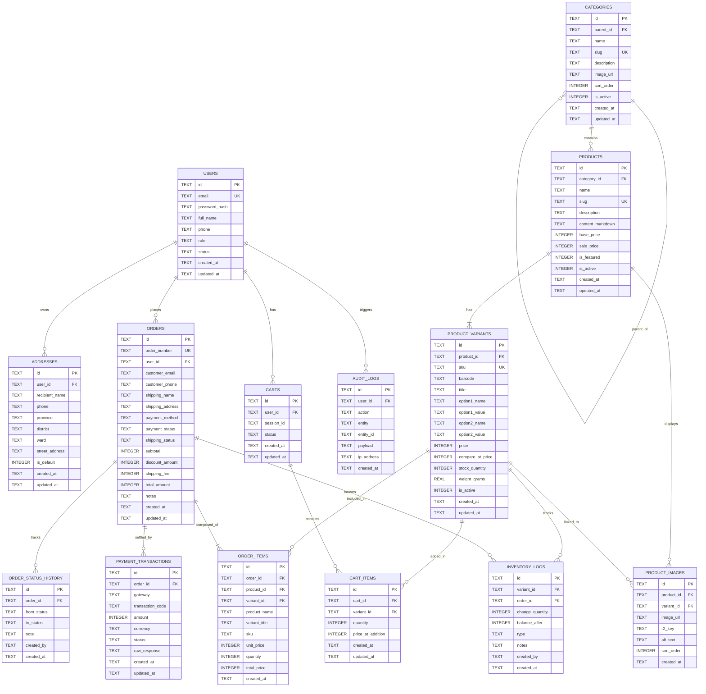

# Database Design Document - EdgeCart (Cloudflare D1)

## 1. Tổng quan & Đặc tính SQLite trên Cloudflare D1

Cloudflare D1 là cơ sở dữ liệu quan hệ Serverless phân tán tại biên dựa trên SQLite engine. Để xây dựng hệ thống E-commerce hiệu năng cao và toàn vẹn dữ liệu trên D1, cần tuân thủ các quy tắc sau:

1. **Kiểu dữ liệu SQLite (Type Affinities)**:
   - `INTEGER`: Dùng cho số nguyên, cờ boolean (`0` hoặc `1`), số lượng tồn kho, giá tiền (lưu trữ theo đơn vị VNĐ hoặc cents để tránh lỗi làm tròn số thực).
   - `TEXT`: Dùng cho chuỗi ký tự, UUIDv4 (Primary Key), ngày giờ theo chuẩn ISO-8601 (`YYYY-MM-DDTHH:MM:SS.SSSZ`), JSON string.
   - `REAL`: Dùng cho số thực (trọng lượng kg, tỉ lệ phần trăm).
   - `BLOB`: Dữ liệu nhị phân.
2. **Khóa ngoại (Foreign Keys)**: Mặc định SQLite tắt ràng buộc khóa ngoại. Trong mọi migration và connection, phải luôn kích hoạt:
   ```sql
   PRAGMA foreign_keys = ON;
   ```
3. **Primary Key Strategy**: Sử dụng UUIDv4 định dạng chuẩn `TEXT` hoặc ULID (Universally Unique Lexicographically Sortable Identifier) để có thể tạo ID an toàn ngay tại client/edge worker mà không phụ thuộc vào sequence tập trung của DB.
4. **Transactions**: D1 không hỗ trợ `BEGIN TRANSACTION ... COMMIT` tương tác nhiều bước qua HTTP. Thay vào đó, toàn bộ nghiệp vụ nhiều bước (như checkout và trừ kho) bắt buộc phải đóng gói qua **`env.DB.batch([...])`**.

---

## 2. Sơ đồ Quan hệ Thực thể (Entity Relationship Diagram - ERD)



---

## 3. Chi tiết DDL Bảng Dữ liệu & Khóa Ngoại (Schema DDL)

### 3.1 Bảng Người dùng & Địa chỉ (Users & Addresses)
```sql
PRAGMA foreign_keys = ON;

-- 1. Bảng Người dùng
CREATE TABLE IF NOT EXISTS users (
    id TEXT PRIMARY KEY,
    email TEXT NOT NULL UNIQUE COLLATE NOCASE,
    password_hash TEXT NOT NULL,
    full_name TEXT NOT NULL,
    phone TEXT,
    role TEXT NOT NULL DEFAULT 'CUSTOMER' CHECK (role IN ('CUSTOMER', 'SUPER_ADMIN', 'PRODUCT_MANAGER', 'ORDER_OPERATOR')),
    status TEXT NOT NULL DEFAULT 'ACTIVE' CHECK (status IN ('ACTIVE', 'INACTIVE', 'BANNED')),
    created_at TEXT NOT NULL DEFAULT CURRENT_TIMESTAMP,
    updated_at TEXT NOT NULL DEFAULT CURRENT_TIMESTAMP
);

-- 2. Bảng Sổ địa chỉ giao hàng
CREATE TABLE IF NOT EXISTS addresses (
    id TEXT PRIMARY KEY,
    user_id TEXT NOT NULL,
    recipient_name TEXT NOT NULL,
    phone TEXT NOT NULL,
    province TEXT NOT NULL,
    district TEXT NOT NULL,
    ward TEXT NOT NULL,
    street_address TEXT NOT NULL,
    is_default INTEGER NOT NULL DEFAULT 0 CHECK (is_default IN (0, 1)),
    created_at TEXT NOT NULL DEFAULT CURRENT_TIMESTAMP,
    updated_at TEXT NOT NULL DEFAULT CURRENT_TIMESTAMP,
    FOREIGN KEY (user_id) REFERENCES users(id) ON DELETE CASCADE
);
```

### 3.2 Bảng Danh mục & Sản phẩm (Categories & Products Catalog)
```sql
-- 3. Bảng Cây Danh mục
CREATE TABLE IF NOT EXISTS categories (
    id TEXT PRIMARY KEY,
    parent_id TEXT,
    name TEXT NOT NULL,
    slug TEXT NOT NULL UNIQUE COLLATE NOCASE,
    description TEXT,
    image_url TEXT,
    sort_order INTEGER NOT NULL DEFAULT 0,
    is_active INTEGER NOT NULL DEFAULT 1 CHECK (is_active IN (0, 1)),
    created_at TEXT NOT NULL DEFAULT CURRENT_TIMESTAMP,
    updated_at TEXT NOT NULL DEFAULT CURRENT_TIMESTAMP,
    FOREIGN KEY (parent_id) REFERENCES categories(id) ON DELETE SET NULL
);

-- 4. Bảng Sản phẩm Chính (Parent Product)
CREATE TABLE IF NOT EXISTS products (
    id TEXT PRIMARY KEY,
    category_id TEXT NOT NULL,
    name TEXT NOT NULL,
    slug TEXT NOT NULL UNIQUE COLLATE NOCASE,
    description TEXT,
    content_markdown TEXT,
    base_price INTEGER NOT NULL DEFAULT 0 CHECK (base_price >= 0),
    sale_price INTEGER CHECK (sale_price >= 0),
    is_featured INTEGER NOT NULL DEFAULT 0 CHECK (is_featured IN (0, 1)),
    is_active INTEGER NOT NULL DEFAULT 1 CHECK (is_active IN (0, 1)),
    created_at TEXT NOT NULL DEFAULT CURRENT_TIMESTAMP,
    updated_at TEXT NOT NULL DEFAULT CURRENT_TIMESTAMP,
    FOREIGN KEY (category_id) REFERENCES categories(id) ON DELETE RESTRICT
);

-- 5. Bảng Biến thể Sản phẩm (Product Variants / SKUs)
CREATE TABLE IF NOT EXISTS product_variants (
    id TEXT PRIMARY KEY,
    product_id TEXT NOT NULL,
    sku TEXT NOT NULL UNIQUE COLLATE NOCASE,
    barcode TEXT,
    title TEXT NOT NULL, -- e.g. "Đen / L", "Trắng / M"
    option1_name TEXT,   -- e.g. "Color"
    option1_value TEXT,  -- e.g. "Đen"
    option2_name TEXT,   -- e.g. "Size"
    option2_value TEXT,  -- e.g. "L"
    price INTEGER NOT NULL CHECK (price >= 0),
    compare_at_price INTEGER,
    stock_quantity INTEGER NOT NULL DEFAULT 0 CHECK (stock_quantity >= 0),
    weight_grams REAL DEFAULT 0,
    is_active INTEGER NOT NULL DEFAULT 1 CHECK (is_active IN (0, 1)),
    created_at TEXT NOT NULL DEFAULT CURRENT_TIMESTAMP,
    updated_at TEXT NOT NULL DEFAULT CURRENT_TIMESTAMP,
    FOREIGN KEY (product_id) REFERENCES products(id) ON DELETE CASCADE
);

-- 6. Bảng Hình ảnh Sản phẩm (Lưu trữ Metadata R2)
CREATE TABLE IF NOT EXISTS product_images (
    id TEXT PRIMARY KEY,
    product_id TEXT NOT NULL,
    variant_id TEXT,
    image_url TEXT NOT NULL,
    r2_key TEXT NOT NULL,
    alt_text TEXT,
    sort_order INTEGER NOT NULL DEFAULT 0,
    created_at TEXT NOT NULL DEFAULT CURRENT_TIMESTAMP,
    FOREIGN KEY (product_id) REFERENCES products(id) ON DELETE CASCADE,
    FOREIGN KEY (variant_id) REFERENCES product_variants(id) ON DELETE SET NULL
);
```

### 3.3 Bảng Giỏ hàng (Carts & Cart Items)
```sql
-- 7. Bảng Giỏ hàng
CREATE TABLE IF NOT EXISTS carts (
    id TEXT PRIMARY KEY,
    user_id TEXT,
    session_id TEXT,
    status TEXT NOT NULL DEFAULT 'ACTIVE' CHECK (status IN ('ACTIVE', 'MERGED', 'CONVERTED')),
    created_at TEXT NOT NULL DEFAULT CURRENT_TIMESTAMP,
    updated_at TEXT NOT NULL DEFAULT CURRENT_TIMESTAMP,
    FOREIGN KEY (user_id) REFERENCES users(id) ON DELETE CASCADE
);

-- 8. Bảng Chi tiết Giỏ hàng
CREATE TABLE IF NOT EXISTS cart_items (
    id TEXT PRIMARY KEY,
    cart_id TEXT NOT NULL,
    variant_id TEXT NOT NULL,
    quantity INTEGER NOT NULL CHECK (quantity > 0),
    price_at_addition INTEGER NOT NULL,
    created_at TEXT NOT NULL DEFAULT CURRENT_TIMESTAMP,
    updated_at TEXT NOT NULL DEFAULT CURRENT_TIMESTAMP,
    FOREIGN KEY (cart_id) REFERENCES carts(id) ON DELETE CASCADE,
    FOREIGN KEY (variant_id) REFERENCES product_variants(id) ON DELETE CASCADE,
    UNIQUE(cart_id, variant_id)
);
```

### 3.4 Bảng Đơn hàng, Thanh toán & Lịch sử Trạng thái (Orders & Payments)
```sql
-- 9. Bảng Đơn hàng
CREATE TABLE IF NOT EXISTS orders (
    id TEXT PRIMARY KEY,
    order_number TEXT NOT NULL UNIQUE,
    user_id TEXT,
    customer_email TEXT NOT NULL,
    customer_phone TEXT NOT NULL,
    shipping_name TEXT NOT NULL,
    shipping_address TEXT NOT NULL,
    shipping_province TEXT NOT NULL,
    shipping_district TEXT NOT NULL,
    shipping_ward TEXT NOT NULL,
    payment_method TEXT NOT NULL CHECK (payment_method IN ('COD', 'VNPAY', 'MOMO', 'STRIPE', 'BANK_TRANSFER')),
    payment_status TEXT NOT NULL DEFAULT 'UNPAID' CHECK (payment_status IN ('UNPAID', 'PAID', 'REFUNDED', 'FAILED')),
    shipping_status TEXT NOT NULL DEFAULT 'PENDING' CHECK (shipping_status IN ('PENDING', 'CONFIRMED', 'PROCESSING', 'SHIPPING', 'DELIVERED', 'CANCELLED', 'RETURNED')),
    subtotal INTEGER NOT NULL CHECK (subtotal >= 0),
    discount_amount INTEGER NOT NULL DEFAULT 0 CHECK (discount_amount >= 0),
    shipping_fee INTEGER NOT NULL DEFAULT 0 CHECK (shipping_fee >= 0),
    total_amount INTEGER NOT NULL CHECK (total_amount >= 0),
    notes TEXT,
    created_at TEXT NOT NULL DEFAULT CURRENT_TIMESTAMP,
    updated_at TEXT NOT NULL DEFAULT CURRENT_TIMESTAMP,
    FOREIGN KEY (user_id) REFERENCES users(id) ON DELETE SET NULL
);

-- 10. Bảng Chi tiết Mặt hàng trong Đơn hàng
CREATE TABLE IF NOT EXISTS order_items (
    id TEXT PRIMARY KEY,
    order_id TEXT NOT NULL,
    product_id TEXT NOT NULL,
    variant_id TEXT NOT NULL,
    product_name TEXT NOT NULL,
    variant_title TEXT NOT NULL,
    sku TEXT NOT NULL,
    unit_price INTEGER NOT NULL CHECK (unit_price >= 0),
    quantity INTEGER NOT NULL CHECK (quantity > 0),
    total_price INTEGER NOT NULL CHECK (total_price >= 0),
    created_at TEXT NOT NULL DEFAULT CURRENT_TIMESTAMP,
    FOREIGN KEY (order_id) REFERENCES orders(id) ON DELETE CASCADE
);

-- 11. Bảng Lịch sử Chuyển trạng thái Đơn hàng
CREATE TABLE IF NOT EXISTS order_status_history (
    id TEXT PRIMARY KEY,
    order_id TEXT NOT NULL,
    from_status TEXT,
    to_status TEXT NOT NULL,
    note TEXT,
    created_by TEXT,
    created_at TEXT NOT NULL DEFAULT CURRENT_TIMESTAMP,
    FOREIGN KEY (order_id) REFERENCES orders(id) ON DELETE CASCADE
);

-- 12. Bảng Giao dịch Thanh toán
CREATE TABLE IF NOT EXISTS payment_transactions (
    id TEXT PRIMARY KEY,
    order_id TEXT NOT NULL,
    gateway TEXT NOT NULL,
    transaction_code TEXT,
    amount INTEGER NOT NULL,
    currency TEXT NOT NULL DEFAULT 'VND',
    status TEXT NOT NULL CHECK (status IN ('PENDING', 'SUCCESS', 'FAILED')),
    raw_response TEXT,
    created_at TEXT NOT NULL DEFAULT CURRENT_TIMESTAMP,
    updated_at TEXT NOT NULL DEFAULT CURRENT_TIMESTAMP,
    FOREIGN KEY (order_id) REFERENCES orders(id) ON DELETE CASCADE
);
```

### 3.5 Bảng Audit Log & Biến động Kho hàng (Ledger & Audit)
```sql
-- 13. Sổ cái Biến động Tồn kho (Immutable Inventory Ledger)
CREATE TABLE IF NOT EXISTS inventory_logs (
    id TEXT PRIMARY KEY,
    variant_id TEXT NOT NULL,
    order_id TEXT,
    change_quantity INTEGER NOT NULL, -- Số âm (xuất hàng/bán) hoặc số dương (nhập kho)
    balance_after INTEGER,
    type TEXT NOT NULL CHECK (type IN ('ORDER_DEDUCT', 'ORDER_CANCEL_RESTOCK', 'MANUAL_IMPORT', 'MANUAL_ADJUST', 'DAMAGED_DISCARD')),
    notes TEXT,
    created_by TEXT,
    created_at TEXT NOT NULL DEFAULT CURRENT_TIMESTAMP,
    FOREIGN KEY (variant_id) REFERENCES product_variants(id) ON DELETE CASCADE,
    FOREIGN KEY (order_id) REFERENCES orders(id) ON DELETE SET NULL
);

-- 14. Bảng Audit Log Hệ thống Quản trị
CREATE TABLE IF NOT EXISTS audit_logs (
    id TEXT PRIMARY KEY,
    user_id TEXT,
    action TEXT NOT NULL,
    entity TEXT NOT NULL,
    entity_id TEXT,
    payload TEXT,
    ip_address TEXT,
    created_at TEXT NOT NULL DEFAULT CURRENT_TIMESTAMP,
    FOREIGN KEY (user_id) REFERENCES users(id) ON DELETE SET NULL
);
```

---

## 4. Chiến lược Indexing Tối ưu hóa Truy vấn Edge (Indexes Optimization)

Trên SQLite, việc thiếu index sẽ dẫn đến **Table Scan**, làm chậm Worker và vượt ngưỡng giới hạn CPU time. Cần thiết lập các Composite Index chuẩn xác:

```sql
-- Indexes cho Users & Addresses
CREATE INDEX IF NOT EXISTS idx_addresses_user_id ON addresses(user_id);
CREATE INDEX IF NOT EXISTS idx_users_role_status ON users(role, status);

-- Indexes cho Categories & Products
CREATE INDEX IF NOT EXISTS idx_categories_parent_order ON categories(parent_id, sort_order);
CREATE INDEX IF NOT EXISTS idx_products_category_active ON products(category_id, is_active);
CREATE INDEX IF NOT EXISTS idx_products_featured_created ON products(is_featured, created_at DESC) WHERE is_active = 1;
CREATE INDEX IF NOT EXISTS idx_products_slug ON products(slug);

-- Indexes cho Variants & Images
CREATE INDEX IF NOT EXISTS idx_variants_product_id ON product_variants(product_id);
CREATE INDEX IF NOT EXISTS idx_variants_sku ON product_variants(sku);
CREATE INDEX IF NOT EXISTS idx_variants_stock ON product_variants(stock_quantity);
CREATE INDEX IF NOT EXISTS idx_product_images_product_sort ON product_images(product_id, sort_order);

-- Indexes cho Carts
CREATE INDEX IF NOT EXISTS idx_carts_user_status ON carts(user_id, status);
CREATE INDEX IF NOT EXISTS idx_carts_session_status ON carts(session_id, status);
CREATE INDEX IF NOT EXISTS idx_cart_items_cart_id ON cart_items(cart_id);

-- Indexes cho Orders & Payments
CREATE INDEX IF NOT EXISTS idx_orders_user_created ON orders(user_id, created_at DESC);
CREATE INDEX IF NOT EXISTS idx_orders_order_number ON orders(order_number);
CREATE INDEX IF NOT EXISTS idx_orders_status ON orders(shipping_status, payment_status);
CREATE INDEX IF NOT EXISTS idx_order_items_order_id ON order_items(order_id);
CREATE INDEX IF NOT EXISTS idx_payment_transactions_order_id ON payment_transactions(order_id);

-- Indexes cho Inventory & Audit Logs
CREATE INDEX IF NOT EXISTS idx_inventory_logs_variant_created ON inventory_logs(variant_id, created_at DESC);
CREATE INDEX IF NOT EXISTS idx_audit_logs_entity_created ON audit_logs(entity, entity_id, created_at DESC);
```

---

## 5. Quy trình Quản lý Migrations & Seed Data với Wrangler

### 5.1 Cấu trúc Thư mục Migrations
```
apps/api/migrations/
├── 0001_initial_schema.sql
├── 0002_add_indexes.sql
└── 0003_seed_demo_data.sql
```

### 5.2 Lệnh Thực thi Migrations
```bash
# 1. Tạo migration mới
pnpm wrangler d1 migrations create edgecart-db add_payment_providers

# 2. Chạy migration trên môi trường Local (Miniflare SQLite local)
pnpm wrangler d1 migrations apply edgecart-db --local

# 3. Chạy migration trên môi trường Staging
pnpm wrangler d1 migrations apply edgecart-db --env staging

# 4. Chạy migration trên môi trường Production
pnpm wrangler d1 migrations apply edgecart-db --remote
```

### 5.3 Chính sách Sao lưu & Phục hồi (Backup & Recovery)
- **Tự động sao lưu**: D1 tự động kích hoạt daily snapshot.
- **Thủ công trước đợt release lớn**:
  ```bash
  # Xuất bản sao lưu dữ liệu production
  pnpm wrangler d1 export edgecart-db --remote --output=./backups/d1_prod_$(date +%Y%m%d_%H%M%S).sql
  ```
- **Khôi phục (Restore)**:
  ```bash
  pnpm wrangler d1 execute edgecart-db --remote --file=./backups/d1_prod_20261028.sql
  ```
