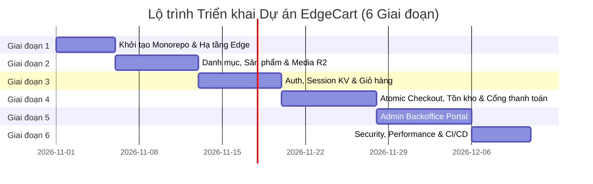

# Implementation & Deployment Plan - EdgeCart

## 1. Cấu trúc Dự án (Monorepo Project Structure)

EdgeCart được tổ chức theo kiến trúc **Monorepo** sử dụng `pnpm workspaces` để chia sẻ mã nguồn (Zod Schemas, TypeScript Interfaces, DTOs, Constants) dùng chung giữa Frontend (Vue 3) và Backend Edge API (Hono.js).

```
d:/EdgeCart/
├── .github/
│   └── workflows/
│       ├── ci.yml                     # Kiểm thử tự động (Unit, Integration, Typecheck)
│       ├── deploy-staging.yml          # Tự động deploy nhánh `staging`
│       └── deploy-prod.yml             # Tự động deploy nhánh `main` lên Production
├── apps/
│   ├── web/                           # Frontend Vue 3 Web Application (Pages)
│   │   ├── public/                    # Static favicon, robots.txt, manifest
│   │   ├── src/
│   │   │   ├── assets/                # Icons, CSS styles (Tailwind)
│   │   │   ├── components/            # Reusable UI components (Button, Modal, Card...)
│   │   │   ├── layouts/               # StorefrontLayout, AdminLayout, AuthLayout
│   │   │   ├── pages/                 # Route views (Home, ProductDetail, Cart, Checkout, Admin...)
│   │   │   ├── router/                # Vue Router 4 (Guards, Dynamic routes)
│   │   │   ├── stores/                # Pinia Stores (useCartStore, useAuthStore, useUIStore)
│   │   │   ├── services/              # API Client (ky / axios / TanStack Vue Query hooks)
│   │   │   ├── App.vue
│   │   │   └── main.ts
│   │   ├── index.html
│   │   ├── vite.config.ts
│   │   ├── tailwind.config.js
│   │   └── package.json
│   │
│   └── api/                           # Backend Hono.js on Cloudflare Workers
│       ├── src/
│       │   ├── controllers/           # Auth, Products, Cart, Checkout, Admin controllers
│       │   ├── middlewares/           # auth.ts, rateLimit.ts, idempotency.ts, cors.ts, error.ts
│       │   ├── services/              # Domain logic (OrderService, InventoryService, PaymentService)
│       │   ├── db/                    # D1 client wrapper, repositories, helpers
│       │   ├── utils/                 # crypto.ts (WebCrypto PBKDF2), jwt.ts, response.ts
│       │   ├── types/                 # Worker Env Bindings (DB, KV, R2, Secrets)
│       │   └── index.ts               # Hono App Entry Point & Route Definitions
│       ├── migrations/                # D1 SQL Migrations
│       │   ├── 0001_initial_schema.sql
│       │   └── 0002_add_indexes.sql
│       ├── wrangler.jsonc             # Cloudflare Workers & Bindings Configuration
│       ├── vitest.config.ts           # Vitest with Miniflare Workers Pool
│       └── package.json
│
├── packages/
│   ├── shared/                        # Shared Code between Web & API
│   │   ├── src/
│   │   │   ├── schemas/               # Zod Schemas (AuthSchema, ProductSchema, CheckoutSchema)
│   │   │   ├── types/                 # Shared Data Models & DTO Interfaces
│   │   │   └── constants/             # OrderStatus, PaymentStatus, Roles, CacheKeys
│   │   ├── package.json
│   │   └── tsconfig.json
│   │
│   └── tsconfig/                      # Shared TypeScript Base Configs
│       ├── base.json
│       └── package.json
│
├── docs/                              # Toàn bộ tài liệu Thiết kế & Quy chuẩn
│   ├── PRD.md
│   ├── ARCHITECTURE.md
│   ├── DATABASE.md
│   ├── API_SPEC.md
│   ├── TEST_PLAN.md
│   └── IMPLEMENTATION_PLAN.md
│
├── pnpm-workspace.yaml
├── package.json                       # Root scripts (build, test, lint, dev)
└── README.md
```

---

## 2. Kế hoạch Môi trường & Triển khai Cloudflare (Multi-Environment Strategy)

EdgeCart được cấu hình cô lập theo 3 môi trường riêng biệt:

| Môi trường | Domain Frontend (Pages) | Domain Backend (Workers) | D1 Database | KV Namespace | R2 Bucket |
| :--- | :--- | :--- | :--- | :--- | :--- |
| **Development** | `http://localhost:5173` | `http://localhost:8787` | Local Miniflare SQLite | Local In-Memory KV | Local In-Memory R2 |
| **Staging** | `https://staging.edgecart.com` | `https://api-staging.edgecart.com` | `edgecart-d1-staging` | `EDGECART_KV_STAGING` | `edgecart-media-staging` |
| **Production** | `https://edgecart.com` | `https://api.edgecart.com` | `edgecart-d1-prod` | `EDGECART_KV_PROD` | `edgecart-media-prod` |

### 2.1 Bản thiết kế Cấu hình Wrangler (`apps/api/wrangler.jsonc`)
```jsonc
{
  "$schema": "node_modules/wrangler/config-schema.json",
  "name": "edgecart-api",
  "main": "src/index.ts",
  "compatibility_date": "2026-10-28",
  "compatibility_flags": ["nodejs_compat"],

  // 1. D1 Database Binding
  "d1_databases": [
    {
      "binding": "DB",
      "database_name": "edgecart-d1-prod",
      "database_id": "00000000-0000-0000-0000-000000000000"
    }
  ],

  // 2. Cloudflare KV Binding
  "kv_namespaces": [
    {
      "binding": "KV",
      "id": "prod_kv_namespace_id"
    }
  ],

  // 3. Cloudflare R2 Bucket Binding
  "r2_buckets": [
    {
      "binding": "R2",
      "bucket_name": "edgecart-media-prod"
    }
  ],

  // 4. Staging Environment Overrides
  "env": {
    "staging": {
      "name": "edgecart-api-staging",
      "d1_databases": [
        {
          "binding": "DB",
          "database_name": "edgecart-d1-staging",
          "database_id": "11111111-1111-1111-1111-111111111111"
        }
      ],
      "kv_namespaces": [
        {
          "binding": "KV",
          "id": "staging_kv_namespace_id"
        }
      ],
      "r2_buckets": [
        {
          "binding": "R2",
          "bucket_name": "edgecart-media-staging"
        }
      ],
      "vars": {
        "ENVIRONMENT": "staging",
        "APP_URL": "https://staging.edgecart.com"
      }
    }
  },

  // 5. Environment Variables
  "vars": {
    "ENVIRONMENT": "production",
    "APP_URL": "https://edgecart.com"
  }
}
```

---

## 3. Lộ trình Triển khai Chi tiết Từng Giai đoạn (Phased Implementation Roadmap)



### Giai đoạn 1: Khởi tạo Nền tảng & Cấu hình Monorepo (Ngày 1 - Ngày 5)
- [ ] Thiết lập pnpm workspace, cấu hình base TypeScript (`packages/tsconfig`), ESLint, Prettier.
- [ ] Khởi tạo package `@edgecart/shared` với Zod schemas mẫu.
- [ ] Khởi tạo Worker backend Hono.js tại `apps/api`, cấu hình `wrangler.jsonc`.
- [ ] Thiết lập thư mục migration SQLite cho D1 và chạy khởi tạo schema ban đầu trên Miniflare local.
- [ ] Khởi tạo Vue 3 SPA tại `apps/web` với Vite, TypeScript, Tailwind CSS, Vue Router, Pinia.

### Giai đoạn 2: Quản lý Dữ liệu Danh mục, Sản phẩm & Tích hợp R2 (Ngày 6 - Ngày 12)
- [ ] Viết Hono REST API cho Categories và Products (CRUD cho Admin, lọc & tìm kiếm cho Storefront).
- [ ] Cấu hình cơ chế đọc qua KV Cache và tự động fallback về D1.
- [ ] Triển khai Endpoint cấp Presigned URL tải ảnh trực tiếp lên Cloudflare R2 (`POST /uploads/presigned-url`).
- [ ] Xây dựng giao diện Danh mục sản phẩm (Catalog Grid), bộ lọc theo giá/danh mục, và Trang chi tiết sản phẩm (PDP) trên Vue 3.

### Giai đoạn 3: Xác thực Người dùng, Quản lý Phiên & Giỏ hàng (Ngày 13 - Ngày 19)
- [ ] Xây dựng Web Crypto PBKDF2 hashing helper và middleware ký/kiểm tra JWT tại Edge.
- [ ] Triển khai lưu trữ session và blacklist thu hồi token trong Cloudflare KV.
- [ ] Xây dựng Pinia `useCartStore` trên Vue 3 hỗ trợ lưu `localStorage` cho khách vãng lai.
- [ ] Triển khai API Giỏ hàng trên D1 và cơ chế tự động gộp giỏ hàng (`POST /cart/merge`) khi đăng nhập.

### Giai đoạn 4: Atomic Checkout, Khóa Tồn kho & Tích hợp Thanh toán (Ngày 20 - Ngày 27)
- [ ] Triển khai Middleware kiểm tra `Idempotency-Key` sử dụng Cloudflare KV.
- [ ] Viết logic checkout bằng `env.DB.batch([...])` với câu lệnh Atomic Conditional UPDATE tồn kho chống over-selling.
- [ ] Ghi nhận toàn bộ biến động vào sổ cái `inventory_logs`.
- [ ] Xây dựng luồng tích hợp Cổng thanh toán trực tuyến (VNPay / Stripe) và webhook xử lý xác nhận giao dịch bảo mật với chữ ký HMAC.

### Giai đoạn 5: Cổng Quản trị Viên (Admin Backoffice Portal) (Ngày 28 - Ngày 35)
- [ ] Xây dựng Layout Admin với Vue 3 và phân quyền RBAC dựa trên JWT role claims.
- [ ] Xây dựng các trang: Quản trị Sản phẩm & Biến thể, Quản trị Danh mục, Quản trị Đơn hàng.
- [ ] Xây dựng giao diện Điều chỉnh Tồn kho thủ công kèm lý do và xem lịch sử xuất nhập.
- [ ] Xây dựng Dashboard số liệu thống kê doanh thu và đơn hàng mới.

### Giai đoạn 6: Tối ưu Hóa Biên, Bảo mật WAF & Tự động Hóa CI/CD (Ngày 36 - Ngày 40)
- [ ] Tích hợp Cloudflare Turnstile CAPTCHA tại trang Checkout và Login.
- [ ] Cấu hình Rate Limiting Middleware tại Edge cho các endpoint nhạy cảm.
- [ ] Thiết lập quy trình kích hoạt xóa Edge Cache (Purge by Cache-Tag) khi Admin cập nhật sản phẩm.
- [ ] Thiết lập GitHub Actions tự động kiểm thử và deploy lên Cloudflare Pages (Web) và Cloudflare Workers (API).

---

## 4. Các Quyết định Kiến trúc Cần Bạn Xác nhận (Decisions Needing User Confirmation)

Trước khi tiến hành viết code triển khai thực tế, kính đề nghị bạn xác nhận các quyết định kiến trúc chiến lược sau:

### Quyết định 1: Mô hình Triển khai Frontend (Storefront & Admin)
- **Phương án A (Khuyến nghị)**: **Single Unified SPA**. Gom chung Storefront và Admin Portal vào cùng một ứng dụng Vue 3 tại `apps/web`, phân tách bằng Route Guards và Lazy Loading (`/admin/*`).
  - *Ưu điểm*: Tận dụng chung UI component library (buttons, inputs, modals), Pinia stores, giảm thiểu chi phí build/deploy trên Cloudflare Pages.
- **Phương án B**: **Two Separate SPAs** (`apps/storefront` và `apps/admin`).
  - *Ưu điểm*: Tách biệt hoàn toàn mã nguồn admin khỏi người dùng cuối, dung lượng bundle của khách hàng nhỏ hơn tối đa.
  - *Nhược điểm*: Cần quản lý 2 dự án Cloudflare Pages độc lập và đồng bộ 2 frontend repo.

### Quyết định 2: Chiến lược Tích hợp Cổng Thanh toán Ưu tiên
- Cần xác nhận cổng thanh toán chính được tích hợp trước trong giai đoạn 1:
  - **Phương án A**: **VNPay Sandbox / QR Pay** (Phù hợp nhất với thị trường thương mại điện tử Việt Nam).
  - **Phương án B**: **Stripe Payment Intent** (Thanh toán thẻ quốc tế Visa/Mastercard, hỗ trợ webhook toàn cầu).
  - **Phương án C**: **PayOS / VietQR** (Chuyển khoản ngân hàng tự động xác nhận qua webhook Open Banking miễn phí tại VN).

### Quyết định 3: Giải pháp Mã hóa Mật khẩu tại Edge Runtime
- **Phương án A (Khuyến nghị)**: **Web Crypto API (PBKDF2-HMAC-SHA256, 100k iterations)**.
  - *Ưu điểm*: 100% native Web Standards, không phụ thuộc thư viện ngoài, chạy siêu nhanh và hoàn toàn tương thích trên V8 Isolate của Cloudflare Workers.
- **Phương án B**: **Argon2id biên dịch qua WebAssembly (WASM)**.
  - *Ưu điểm*: Khả năng chống tấn công brute-force ASIC/GPU tốt nhất hiện nay.
  - *Nhược điểm*: Tăng dung lượng bundle của Worker thêm khoảng 80KB-120KB và tiêu tốn thêm khoảng 15-20ms CPU time của Worker.

### Quyết định 4: Cơ chế Lưu trữ Session Đăng nhập
- **Phương án A (Khuyến nghị)**: **Stateless JWT trong Authorization Header kết hợp KV Blacklist cho Logout**.
  - *Ưu điểm*: Phù hợp hoàn hảo với kiến trúc Edge API, xác thực chữ ký cục bộ bằng WebCrypto trong 0ms mà không tốn network round-trip vào KV/DB.
- **Phương án B**: **Stateful Session ID lưu trong HTTP-Only Cookie đọc trực tiếp từ Cloudflare KV mỗi request**.
  - *Ưu điểm*: Thu hồi quyền tức thì 100%, bảo mật cao hơn trước XSS.
  - *Nhược điểm*: Mỗi API request đều tốn 1 lần đọc Cloudflare KV (~5-15ms).

---

## 5. Bảng Phân tích Rủi ro & Giải pháp Giảm thiểu (Critical Risks & Mitigation Matrix)

| STT | Rủi ro Tiềm ẩn (Risk) | Mức độ | Hậu quả (Impact) | Giải pháp Giảm thiểu Kiến trúc (Mitigation Strategy) |
| :---: | :--- | :---: | :--- | :--- |
| **1** | **Giới hạn Ghi của D1 (Write Bottleneck)** | **Cao** | D1 sử dụng SQLite với Single Primary Writer. Nếu có quá nhiều transaction ghi đồng thời kéo dài, sẽ phát sinh lỗi lock timeout hoặc chậm hệ thống. | - Tối ưu triệt để: Mọi thao tác checkout gom vào 1 `env.DB.batch([...])` duy nhất.<br/>- Đưa toàn bộ các thao tác ghi log không quan trọng (view count, audit log) sang **Cloudflare Queues** để ghi bất đồng bộ, không giữ transaction chính. |
| **2** | **Tính Nhất quán Sau (Eventual Consistency) của KV** | **Trung bình** | Dữ liệu ghi vào KV mất 10s-60s để đồng bộ sang tất cả 330+ PoPs trên toàn cầu. Khách hàng có thể đọc phải dữ liệu cũ nếu dùng KV sai mục đích. | - **Tuyệt đối không lưu tồn kho vào KV**.<br/>- KV chỉ dùng cho Session whitelist, cấu hình tĩnh, và Cache chi tiết sản phẩm.<br/>- Đối với dữ liệu giỏ hàng và đặt hàng, luôn đọc/ghi trực tiếp từ Cloudflare D1. |
| **3** | **Vượt ngưỡng CPU Time Limits của Workers** | **Trung bình** | Worker gói miễn phí giới hạn 50ms CPU time; gói Workers Paid giới hạn 30s. Nếu xử lý ảnh hoặc hashing quá nặng, request sẽ bị Cloudflare ngắt. | - **Tuyệt đối không resize ảnh trên Worker**: Sử dụng Presigned URL để client upload thẳng lên Cloudflare R2; nén/resize ảnh trước bằng Canvas API ở client hoặc dùng Cloudflare Images SaaS.<br/>- Cân đối số vòng lặp PBKDF2 (100,000 iterations tiêu tốn ~8-12ms CPU). |
| **4** | **Bán vượt tồn kho (Over-selling) trong Flash-Sale** | **Nghiêm trọng** | Nhiều khách hàng cùng bấm mua 1 sản phẩm còn tồn kho ít tại cùng 1 mili-giây dẫn đến âm kho. | - Sử dụng kỹ thuật **Atomic Conditional UPDATE** trong SQL: `UPDATE ... WHERE id = ? AND stock >= ?`.<br/>- Kiểm tra `meta.changes === 0` để rollback và từ chối đơn hàng tức thì.<br/>- Bắt buộc áp dụng header `Idempotency-Key` với KV. |
| **5** | **Xác thực Webhook Thanh toán không an toàn** | **Cao** | Kẻ xấu giả mạo request webhook của VNPay/Stripe để đánh dấu đơn hàng là đã thanh toán thành công. | - Bắt buộc kiểm tra chữ ký số mật mã (`HMAC-SHA512` của VNPay hoặc `HMAC-SHA256` của Stripe) bằng Secret Key lưu an toàn trong Cloudflare Secrets (`wrangler secret put`).<br/>- Kiểm tra tính hợp lệ của số tiền thanh toán thực tế so với `total_amount` trong D1 trước khi đổi trạng thái đơn. |
