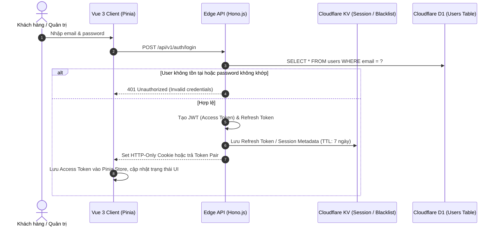
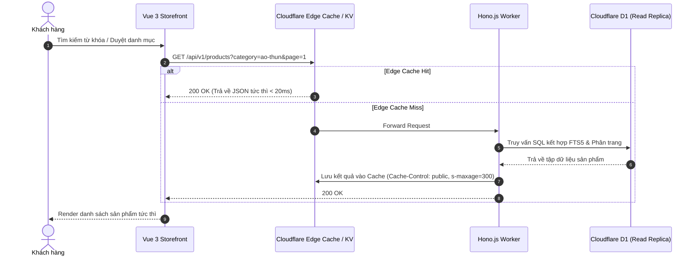
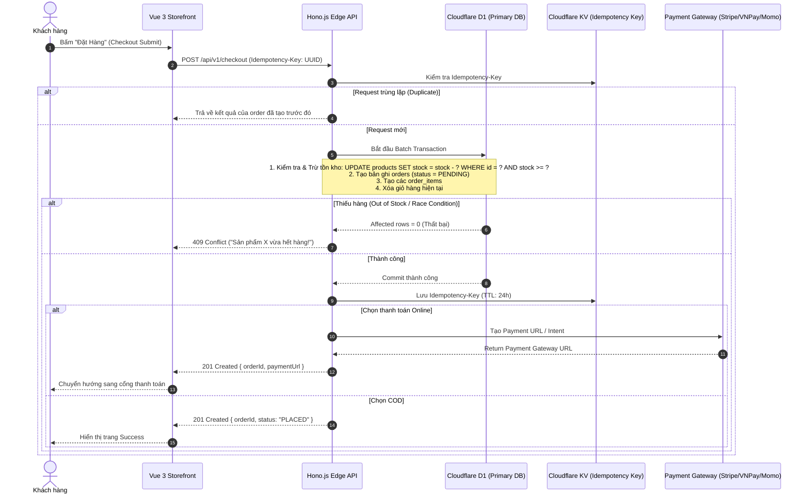

# Product Requirements Document (PRD) - EdgeCart

## 1. Tổng quan Dự án (Project Overview)

### 1.1 Tầm nhìn (Vision)
**EdgeCart** là nền tảng thương mại điện tử (E-commerce) thế hệ mới được thiết kế hoàn toàn theo mô hình **Edge-First Native**. Bằng cách vận hành toàn bộ tầng Frontend, API Gateway, Application Logic và Database Caching trên mạng lưới toàn cầu của Cloudflare (330+ PoPs), EdgeCart mang đến trải nghiệm mua sắm với độ trễ tính bằng mili-giây (< 50ms TTFB toàn cầu), khả năng chịu tải cao trong các đợt flash-sale, giảm thiểu tối đa chi phí vận hành hạ tầng truyền thống (serverless, no-idle-cost).

### 1.2 Mục tiêu Dự án (Objectives & KPIs)
- **Hiệu năng (Performance)**: TTFB (Time to First Byte) < 80ms P95 toàn cầu; LCP (Largest Contentful Paint) < 1.8s; FID/INP < 100ms; CLS < 0.05.
- **Tính khả dụng (High Availability)**: 99.95% uptime tận dụng hạ tầng anycast network của Cloudflare.
- **Trải nghiệm mua sắm (Conversion Rate)**: Giảm thiểu abandonment rate bằng trải nghiệm giỏ hàng tức thì (Instant Cart) và quy trình checkout tối ưu hóa tốc độ.
- **Khả năng mở rộng (Scalability)**: Tự động co giãn theo lưu lượng mà không cần quản lý cụm container hoặc server thủ công.

### 1.3 Tech Stack Cốt lõi
- **Frontend Storefront & Admin Portal**: Vue 3 (Composition API, `<script setup>`), TypeScript, Vite, Tailwind CSS, Pinia, Vue Router, TanStack Vue Query.
- **Backend Edge API**: Hono.js trên Cloudflare Workers runtime (V8 isolates siêu nhẹ, thời gian khởi động < 5ms).
- **Database (Relational)**: Cloudflare D1 (SQLite distributed database tại Edge với single-primary write và multi-replica edge read).
- **Fast Cache & Session**: Cloudflare KV (Key-Value store phân tán toàn cầu, độ trễ đọc cực thấp).
- **Object Storage**: Cloudflare R2 (S3-compatible, không phí egress, lưu trữ hình ảnh sản phẩm và tài liệu).
- **Async Processing & Scheduled Tasks**: Cloudflare Queues / Cron Triggers (xử lý đơn hàng nền, gửi email, tổng hợp báo cáo).

---

## 2. Phân tích Personas & Đối tượng Người dùng

### 2.1 Khách hàng Mua sắm (Customer / Shopper)
- **Khách vãng lai (Guest Shopper)**: Xem danh mục, tìm kiếm sản phẩm, lọc theo giá/thuộc tính, thêm vào giỏ hàng cục bộ mà không bắt buộc đăng nhập ngay.
- **Khách hàng thân thiết (Registered Shopper)**: Quản lý sổ địa chỉ, lịch sử đơn hàng, giỏ hàng đồng bộ đa thiết bị, lưu danh sách yêu thích, đánh giá sản phẩm.

### 2.2 Quản trị viên & Nhân viên (Admin & Operations)
- **Super Admin**: Quản trị toàn bộ cấu hình hệ thống, quản lý tài khoản nhân viên, phân quyền RBAC, xem báo cáo doanh thu tài chính.
- **Product & Inventory Manager**: Quản lý danh mục, thông tin sản phẩm, phân loại biến thể (SKU), cập nhật giá bán, theo dõi và điều chỉnh kho hàng.
- **Order Processing Staff**: Quản lý đơn hàng, đổi trạng thái đơn (Xác nhận, Đóng gói, Bàn giao vận chuyển, Hoàn tất, Hủy đơn), xử lý yêu cầu hoàn trả/đổi hàng.

---

## 3. Phân tích Yêu cầu Chức năng (Functional Requirements)

### 3.1 Nhóm chức năng dành cho Khách hàng (Storefront)

| Mã tính năng | Tên tính năng | Mô tả chi tiết | Tiêu chí chấp nhận (Acceptance Criteria) |
| :--- | :--- | :--- | :--- |
| **CUS-AUTH-01** | Đăng ký & Đăng nhập | Đăng ký bằng Email + Mật khẩu, hỗ trợ Magic Link hoặc OTP; Đăng nhập tạo Session token được xác thực ở Edge. | Mật khẩu được mã hóa an toàn (PBKDF2/Argon2id WebCrypto); kiểm tra tính hợp lệ trước khi lưu; hỗ trợ nhớ phiên đăng nhập qua KV. |
| **CUS-AUTH-02** | Quản lý Tài khoản & Sổ địa chỉ | Xem thông tin cá nhân, cập nhật mật khẩu, quản lý nhiều địa chỉ giao hàng (chọn địa chỉ mặc định). | Khách hàng có thể tạo tối đa 10 địa chỉ; validate chuẩn hóa thông tin địa chỉ Việt Nam (Tỉnh/Thành, Quận/Huyện, Phường/Xã). |
| **CUS-CAT-01** | Duyệt danh mục & Trang chi tiết | Xem cây danh mục, breadcrumbs, trang chi tiết sản phẩm (PDP) với nhiều hình ảnh, biến thể (màu sắc, kích cỡ), mô tả rich text. | Dữ liệu sản phẩm được cache tại Cloudflare KV/Edge Cache; phản hồi < 50ms khi cache hit; hiển thị rõ trạng thái còn/hết hàng theo SKU. |
| **CUS-CAT-02** | Tìm kiếm & Bộ lọc nâng cao | Tìm kiếm từ khóa theo tên/mô tả; lọc theo danh mục, khoảng giá, trạng thái tồn kho; sắp xếp theo mới nhất, bán chạy, giá tăng/giảm. | Hỗ trợ full-text search chuẩn hóa tiếng Việt không dấu; pagination linh hoạt dạng cursor hoặc offset; debounce tìm kiếm ở client. |
| **CUS-CART-01** | Giỏ hàng tức thì (Instant Cart) | Thêm, bớt, cập nhật số lượng, xóa sản phẩm khỏi giỏ hàng. Hỗ trợ giỏ hàng khách vãng lai (Guest Cart lưu LocalStorage) và merge tự động khi đăng nhập. | Khi đăng nhập, giỏ hàng LocalStorage tự động gộp vào giỏ hàng Database; kiểm tra giới hạn tồn kho ngay khi người dùng thao tác tăng số lượng. |
| **CUS-ORD-01** | Quy trình Thanh toán (Checkout) | Chọn địa chỉ giao hàng, phương thức vận chuyển, nhập ghi chú, áp dụng mã giảm giá, chọn phương thức thanh toán (COD, Chuyển khoản QR, Cổng thanh toán trực tuyến). | Khóa tạm thời (hold/lock) tồn kho hoặc kiểm tra atomic inventory deduction tại thời điểm submit đơn hàng; ngăn chặn over-selling khi flash-sale. |
| **CUS-ORD-02** | Theo dõi Đơn hàng | Xem danh sách đơn hàng đã đặt, xem chi tiết timeline trạng thái đơn hàng (Đã đặt -> Đã thanh toán -> Đang chuẩn bị -> Đang giao -> Đã nhận -> Đã hủy). | Khách hàng chỉ xem được đơn hàng của chính mình; có thể yêu cầu hủy đơn nếu đơn hàng còn ở trạng thái `PENDING`/`CONFIRMED`. |

### 3.2 Nhóm chức năng dành cho Quản trị viên (Admin Portal)

| Mã tính năng | Tên tính năng | Mô tả chi tiết | Tiêu chí chấp nhận |
| :--- | :--- | :--- | :--- |
| **ADM-AUTH-01** | Xác thực & Phân quyền Quản trị (RBAC) | Đăng nhập tài khoản quản trị riêng biệt; phân quyền theo Role (`SUPER_ADMIN`, `PRODUCT_MANAGER`, `ORDER_OPERATOR`). | Middleware kiểm tra JWT role; chặn truy cập trái phép; hỗ trợ thu hồi quyền tức thì qua Cloudflare KV. |
| **ADM-PROD-01** | Quản lý Sản phẩm & Biến thể | Tạo mới, sửa, xóa (soft delete), kích hoạt/ẩn sản phẩm. Quản lý SKU, barcode, giá vốn, giá bán, giá khuyến mãi, danh sách ảnh. | Upload ảnh trực tiếp lên Cloudflare R2 qua Presigned URL; tự động xóa cache sản phẩm trên KV khi có cập nhật. |
| **ADM-CAT-01** | Quản lý Danh mục & Thuộc tính | Cây danh mục đa cấp (parent-child), slug tự động chuẩn SEO, gán nhóm thuộc tính (Size, Color, Material). | Không cho phép xóa danh mục nếu đang có sản phẩm hoạt động; tự động tạo slug unique. |
| **ADM-INV-01** | Quản trị Kho & Lịch sử Nhập/Xuất | Xem tồn kho theo SKU; nhập kho, điều chỉnh số lượng tồn kèm lý do; xem audit log biến động kho hàng (Order deduction, Manual adjust, Return). | Ghi log bất biến (immutable inventory ledger) cho mọi thao tác tác động đến số lượng tồn kho. |
| **ADM-ORD-01** | Quản lý & Xử lý Đơn hàng | Tìm kiếm đơn theo mã, số điện thoại; lọc theo trạng thái, ngày đặt; cập nhật trạng thái đơn; in phiếu đóng gói/vận đơn. | State Machine kiểm soát nghiêm ngặt các bước chuyển trạng thái (không thể chuyển từ `CANCELLED` sang `DELIVERED`). |
| **ADM-MEDIA-01**| Quản lý Tệp tin & Media (R2) | Quản lý thư viện hình ảnh tải lên Cloudflare R2; hỗ trợ xem trước, xóa ảnh không sử dụng; tối ưu WebP/AVIF. | Upload không qua máy chủ backend (direct browser-to-R2 upload) để không tiêu tốn CPU time của Cloudflare Workers. |
| **ADM-DASH-01** | Báo cáo & Thống kê Tổng quan | Dashboard số liệu: Doanh thu theo ngày/tháng, số đơn mới, sản phẩm bán chạy, cảnh báo sắp hết hàng. | Dữ liệu được tính toán định kỳ hoặc truy vấn tối ưu trên D1 với index chuyên dụng, tránh full table scan. |

---

## 4. Đặc tả Quy trình Nghiệp vụ Cốt lõi (Core Business Flows)

### 4.1 Luồng Đăng ký & Đăng nhập (Auth Flow)

### 4.2 Luồng Tìm kiếm & Xem Sản phẩm (Search & Browsing Flow)

### 4.3 Luồng Giỏ hàng & Đồng bộ Giỏ hàng (Cart Sync Flow)
1. **Khách vãng lai**: Mọi hành động thêm vào giỏ được lưu trong `localStorage` qua Pinia persist plugin.
2. **Khi Khách hàng đăng nhập thành công**:
   - Client gửi payload `POST /api/v1/cart/merge` chứa các mặt hàng trong `localStorage`.
   - Backend mở Transaction trên D1: gộp số lượng của các mặt hàng trùng SKU, kiểm tra lại tồn kho hiện tại.
   - Trả về Giỏ hàng hợp nhất hoàn chỉnh cho Client. Client xóa giỏ hàng tạm trong `localStorage`.

### 4.4 Luồng Checkout & Xử lý Trừ Tồn kho (Checkout & Concurrency Control Flow)

---

## 5. Yêu cầu Phi chức năng (Non-Functional Requirements)

### 5.1 Hiệu năng & Khả năng đáp ứng (Performance)
- **Time to First Byte (TTFB)**: Dưới 80ms tại 95% vị trí địa lý trên thế giới nhờ Cloudflare Anycast và Edge Cache.
- **Client Bundle Size**: Tối đa 150KB gzip cho Initial Vendor Chunk; áp dụng code-splitting theo từng Route.
- **Optimistic UI Updates**: Thao tác thêm vào giỏ hàng và cập nhật số lượng phản hồi UI trong 0ms (optimistic mutation), đồng bộ ngầm với backend.

### 5.2 Bảo mật & Quyền riêng tư (Security & Compliance)
- **Zero Trust & Edge Shielding**: Sử dụng Cloudflare WAF, DDoS Protection, Rate Limiting (giới hạn 30 req/phút cho các endpoint nhạy cảm như `/login`, `/checkout`).
- **Bot Protection**: Tích hợp Cloudflare Turnstile miễn phí và thân thiện người dùng thay thế Google reCAPTCHA.
- **CORS & Headers**: Strict Content-Security-Policy (CSP), Strict-Transport-Security (HSTS), X-Content-Type-Options: nosniff.
- **Chống gian lận đơn hàng**: Xác thực chữ ký webhook thanh toán (HMAC SHA-256) tại Edge trước khi cập nhật trạng thái đơn.

### 5.3 Độ tin cậy & Toàn vẹn Dữ liệu (Reliability & Data Integrity)
- **ACID Compliance**: Tận dụng D1 Batch API để đảm bảo tính nguyên tố (Atomicity) khi tạo đơn hàng và trừ kho.
- **Idempotency Guarantee**: Áp dụng header `Idempotency-Key` cho toàn bộ các POST request thanh toán và tạo đơn.
- **Tự động sao lưu**: Kích hoạt Cloudflare D1 Automated Backups và Point-In-Time Recovery (PITR).

---

## 6. Ràng buộc & Cân nhắc Kiến trúc Edge (Edge Architectural Constraints)
1. **Cloudflare Workers Execution Limits**: Giới hạn thời gian CPU time (50ms cho Free, 30s cho Paid). Không thực hiện các tác vụ nặng (như resize ảnh trực tiếp); chuyển xử lý media sang Cloudflare Images hoặc client-side canvas pre-resize trước khi đẩy lên R2.
2. **Cloudflare D1 SQLite Behavior**: D1 hoạt động theo mô hình **Single-Primary Writer** (tất cả các query ghi đều được định tuyến về primary location) và **Multi-Replica Reader**. Cần thiết kế câu lệnh ghi ngắn gọn, hạn chế lock kéo dài.
3. **Cloudflare KV Eventual Consistency**: Dữ liệu ghi vào KV mất từ 10s đến 60s để đồng bộ toàn cầu. Do đó, KV chỉ dùng cho session whitelist/blacklist, cache danh mục sản phẩm; **tuyệt đối không dùng KV để lưu trữ số lượng tồn kho chính xác**.
