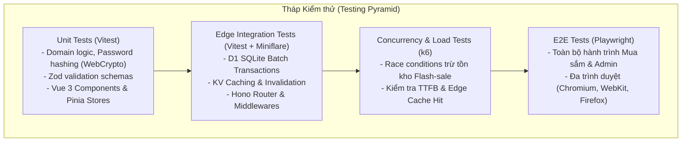

# Test Plan Document - EdgeCart

## 1. Mục tiêu & Phạm vi Kiểm thử (Testing Scope & Strategy)

Hệ thống EdgeCart hoạt động trên môi trường điện toán biên (Cloudflare Workers, D1, KV, R2), do đó chiến lược kiểm thử phải bao phủ cả tính tương thích của môi trường V8 Isolate, mô phỏng lưu trữ phân tán, và đặc biệt là **kiểm thử tương tranh (Concurrency Testing)** trong các kịch bản flash-sale đặt hàng đồng thời.



---

## 2. Các Cấp độ Kiểm thử & Công cụ (Test Levels & Tools)

### 2.1 Unit Testing (Kiểm thử Đơn vị)
- **Công cụ**: `Vitest`, `@vue/test-utils`, `happy-dom`.
- **Phạm vi Backend**:
  - Kiểm tra các hàm mã hóa mật khẩu sử dụng Web Crypto API (`hashPassword`, `verifyPassword`).
  - Kiểm tra việc sinh và giải mã JWT token.
  - Kiểm tra tính hợp lệ của dữ liệu đầu vào thông qua Zod Schema.
  - Tính toán tổng tiền đơn hàng, thuế, phí vận chuyển và mã giảm giá.
- **Phạm vi Frontend**:
  - Pinia Stores (`useCartStore`, `useAuthStore`): Kiểm tra logic thêm/sửa/xóa sản phẩm, persist vào localStorage, gộp giỏ hàng.
  - Vue Components: Render chính xác giá tiền định dạng VNĐ, badge hết hàng, validation form nhập địa chỉ.

### 2.2 Integration Testing với Miniflare (Kiểm thử Tích hợp Biên)
- **Công cụ**: `@cloudflare/vitest-pool-workers` (chạy trực tiếp test suite bên trong môi trường giả lập V8 Isolate của Workers).
- **Phạm vi**:
  - Chạy migration D1 thật trên SQLite in-memory của Miniflare.
  - Kiểm thử toàn bộ vòng đời của Hono API Request -> Middleware (Auth, CORS, RateLimit) -> Service -> D1 Database -> Response.
  - Kiểm thử đọc/ghi/xóa dữ liệu trên Cloudflare KV.
  - Kiểm thử tạo presigned URL với Cloudflare R2.

### 2.3 Concurrency & Race Condition Testing (Kiểm thử Tương tranh & Tranh chấp Tồn kho)
- **Mục tiêu tối thượng**: Đảm bảo tuyệt đối **KHÔNG BAO GIỜ BÁN VƯỢT TỒN KHO (Zero Over-selling)** khi có hàng trăm request tranh chấp cùng một SKU.
- **Kịch bản Test (Vitest / k6 Script)**:
  1. Khởi tạo một biến thể sản phẩm có số lượng tồn kho `stock_quantity = 5`.
  2. Bắn đồng thời **100 requests** `POST /api/v1/checkout` cố gắng mua sản phẩm này (mỗi request mua 1 cái).
  3. **Kết quả mong đợi**:
     - Đúng 5 requests nhận được HTTP `201 Created` và tạo 5 đơn hàng thành công.
     - Đúng 95 requests nhận được HTTP `409 Conflict` với mã lỗi `INSUFFICIENT_STOCK`.
     - Tồn kho cuối cùng của biến thể trong bảng `product_variants` chính xác bằng `0` (không được âm).
     - Bảng `inventory_logs` ghi nhận chính xác 5 bản ghi trừ kho với tổng số lượng giảm là 5.

### 2.4 Idempotency Testing (Kiểm thử Chống Trùng lặp Giao dịch)
- **Kịch bản Test**:
  1. Gửi liên tiếp **5 requests** `POST /api/v1/checkout` với cùng một header `Idempotency-Key: e1a5d2b7-08e1-4569-8083-d05ec2c6110e`.
  2. **Kết quả mong đợi**:
     - Hệ thống chỉ tạo duy nhất 1 bản ghi đơn hàng trong cơ sở dữ liệu D1.
     - Tồn kho chỉ bị trừ duy nhất 1 lần.
     - Cả 5 requests đều trả về cùng một mã `orderId` và thông tin đơn hàng giống hệt nhau.

### 2.5 End-to-End (E2E) Testing với Playwright
- **Công cụ**: Playwright Test Suite.
- **Các Kịch bản Trọng yếu**:
  - **Kịch bản 1 (Full Shopper Journey)**: Khách vãng lai xem sản phẩm -> Thêm vào giỏ -> Đăng ký tài khoản mới -> Giỏ hàng được tự động gộp -> Tiến hành checkout -> Điền địa chỉ giao hàng -> Đặt hàng thành công -> Kiểm tra trang chi tiết đơn hàng.
  - **Kịch bản 2 (Admin Catalog & Inventory)**: Quản trị viên đăng nhập Portal -> Thêm danh mục mới -> Tạo sản phẩm kèm 3 biến thể màu/size -> Tải ảnh lên R2 -> Điều chỉnh số lượng tồn kho -> Mở trang Storefront xác nhận sản phẩm đã xuất hiện tức thì.

---

## 3. Ma trận Truy xuất Nguồn gốc Kiểm thử (Test Traceability Matrix)

| Mã Yêu cầu | Mô tả Nghiệp vụ | Loại Test | Kịch bản Kiểm thử | Tiêu chuẩn Đạt (Pass Criteria) |
| :--- | :--- | :--- | :--- | :--- |
| **CUS-AUTH-01** | Đăng ký & Đăng nhập | Unit / Integration | Nhập sai định dạng email, mật khẩu yếu; Đăng nhập đúng thông tin. | HTTP 422 khi sai định dạng; Cấp đúng token pair và session KV khi hợp lệ. |
| **CUS-CAT-01** | Cache danh mục & chi tiết | Integration / Perf | Gọi API 2 lần liên tiếp; kiểm tra Header `Cache-Control` và `X-Cache`. | Lần 1: DB-MISS; Lần 2: KV-HIT hoặc Edge-HIT với độ trễ < 30ms. |
| **CUS-CART-01** | Gộp giỏ hàng LocalStorage | Unit / E2E | Thêm 2 món khi chưa login; sau đó login và gọi `/cart/merge`. | Giỏ hàng database có đủ 2 món; LocalStorage client được dọn sạch. |
| **CUS-ORD-01** | Trừ tồn kho nguyên tử | Concurrency Test | 50 luồng đồng thời mua biến thể chỉ còn 3 món trong kho. | Chính xác 3 đơn thành công; 47 đơn bị từ chối `INSUFFICIENT_STOCK`. |
| **ADM-PROD-01** | Upload ảnh R2 | Integration | Yêu cầu presigned URL; upload file nhị phân qua PUT; verify URL ảnh. | Presigned URL hợp lệ; R2 nhận tệp; URL CDN truy cập được tệp ảnh. |
| **ADM-ORD-01** | State Machine Đơn hàng | Unit / Integration | Cố gắng cập nhật trạng thái từ `CANCELLED` sang `SHIPPING`. | Bị từ chối với HTTP 400 và thông báo vi phạm chu trình trạng thái đơn. |

---

## 4. Quy trình Thực thi Kiểm thử Tự động (Automated Pipeline Execution)

Kiểm thử được tự động hóa hoàn toàn trong quy trình CI/CD GitHub Actions:
```yaml
# Trích đoạn bước chạy test trong CI
jobs:
  test:
    runs-on: ubuntu-latest
    steps:
      - uses: actions/checkout@v4
      - uses: pnpm/action-setup@v3
      - uses: actions/setup-node@v4
        with:
          node-version: 20
          cache: 'pnpm'

      - name: Install Dependencies
        run: pnpm install --frozen-lockfile

      - name: Run Linter & Typecheck
        run: pnpm -r run typecheck

      - name: Run Unit & Worker Integration Tests
        run: pnpm --filter @edgecart/api test:run

      - name: Run Concurrency Race Condition Tests
        run: pnpm --filter @edgecart/api test:concurrency

      - name: Run Playwright E2E Tests
        run: pnpm --filter @edgecart/web test:e2e
```
